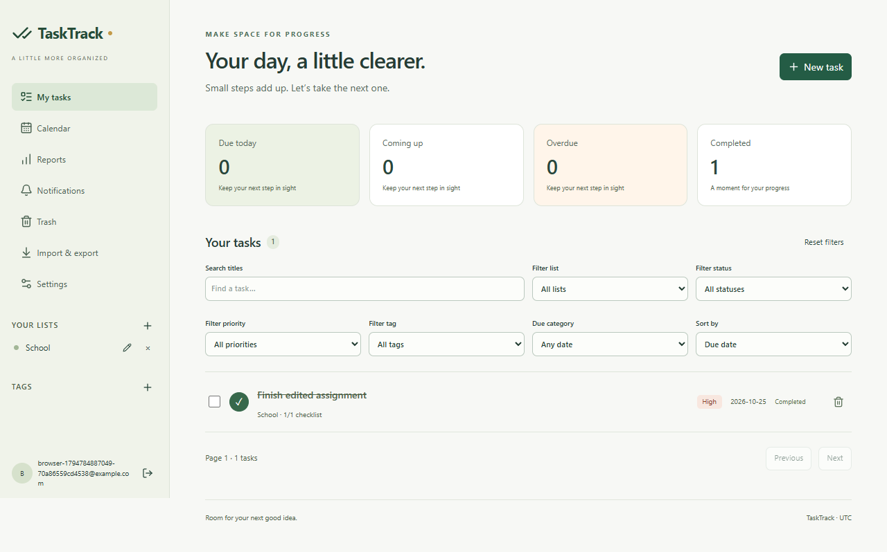
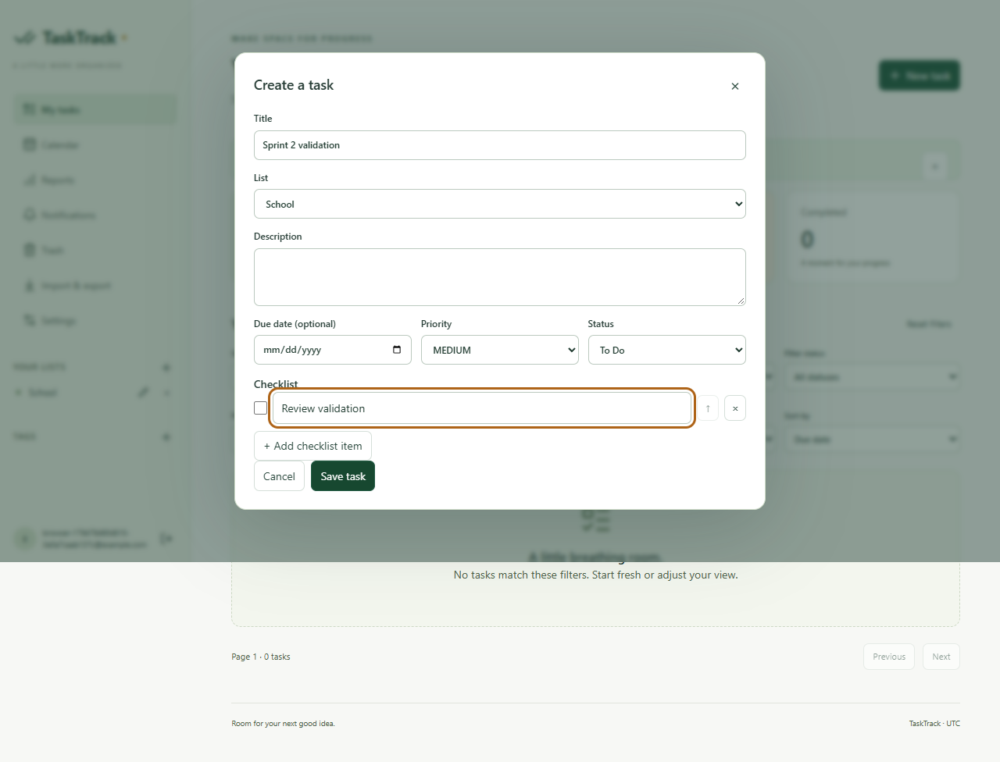
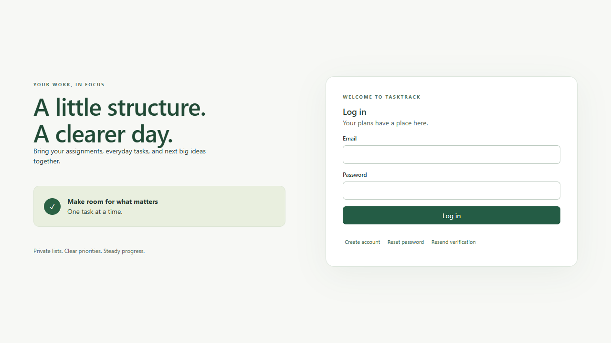
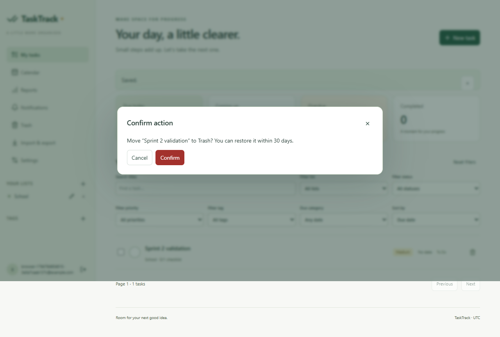

TaskTrack Person D Sprint 2

GUI finalization and integration | CMSC 430 | November 15, 2026

The existing TaskTrack web GUI is connected to the FastAPI backend and PostgreSQL. Sprint 2 adds client-side rejection of whitespace-only names, task titles and checklist entries, with regression tests and a fresh integration run. All 50 automated cases executed for this handoff passed: 33 backend, 9 frontend and 8 browser cases.

This contribution supplies the GUI implementation, screenshots, connection diagram, test evidence and known-defect status for Person A. Actual teammate correspondence, human usability results and the complete team defect register still require team input.

## GUI components and implementation

| Area | Source file | Implemented behavior |
| --- | --- | --- |

| Account screens | Auth.tsx | Register, verify, login, logout and recovery; pending/error messages. |

| Lists and task workspace | Workspace.tsx | Create/rename lists and tags; tasks, status, priority, filters, sorting and pagination. |

| Task details | TaskEditor.tsx | Real task fields, checklist order/completion, tags, dates and versioned saves. |

| Supporting views | Views.tsx | Calendar, reports, notifications, settings, sessions and import/export. |

| Shared controls | Dialog.tsx and api/client.ts | Modal confirmation, labels, asynchronous fetch, CSRF and backend error display. |

## Changes completed in Sprint 2

TaskEditor.tsx applies native HTML pattern validation to titles and checklist text. Workspace.tsx applies the same validation to list and tag names for both creation and renaming. The existing backend independently trims and validates these values. Valid input, optional dates and password handling are preserved.

forms.test.tsx adds a validation and correction case. workflows.spec.ts adds a real-browser case for list, tag, title and checklist rejection, counts create requests, captures screenshots and records automated recovery timing.

Reference baseline: local sprint-1 commit 34f253d, following the earlier TaskTrack work. The remote repository was unreachable during this session, so this package has not been compared with newer GitHub changes. The source patch is included for review before applying.

## GUI and backend connection diagram

Requests travel downward; JSON responses and errors return through the client to rendered state. Vite forwards /api requests to the API during development. In production, the configured proxy serves the same API path. The inspected production client contains real fetch calls rather than a stub service.

| GUI responsibility | API path examples | Backend module |
| --- | --- | --- |

| Auth and settings | /api/auth/*; /api/me; /api/me/sessions | api.py |

| Lists, tasks and tags | /api/lists; /api/tasks; /api/tags; /api/bulk | task_api.py |

| Dashboard and reports | /api/dashboard; /api/reports | task_api.py |

| Schedules and notifications | /api/tasks/{id}/schedule, /recurrence, /reminders; /api/notifications | extras_api.py |

| Data portability | /api/exports; /api/import/preview; /api/import/{id}/apply | extras_api.py |

A task save sends POST /api/tasks or PUT /api/tasks/{id} with the edited fields and the current version for updates. The backend validates ownership and persists the record. On success, the UI invalidates cached queries; on failure, it retains the editor input and displays the error.

Recurrence, reminders and exports also depend on background workers. Browser fixtures inspect their isolated verification mailbox and directly execute the real export worker function. These tests establish GUI/API/database integration but do not establish SMTP or Redis transport success.

## Frontend test cases and results

Execution date: November 15, 2026. Vitest: 2 files passed, 9 tests passed, zero failures. The request boundary is mocked for these component tests; browser integration is reported separately.

| ID | Control or behavior | Expected result and observed result |
| --- | --- | --- |

| F01 | Login | Preserves intentional password spaces and sends credentials; completion callback runs. PASS. |

| F02 | Login failure | Displays invalid-credential response and permits retry. PASS. |

| F03 | Registration constraints | Required email and 12-character password minimum are present; attribute check only. PASS. |

| F04 | Verification link | Reads fragment token, removes it from URL and calls verification endpoint. PASS. |

| F05 | Task save | Sends date, priority, status, tag and reordered/completed checklist. PASS. |

| F06 | Persistence failure | Displays storage error, retains input and keeps editor open. PASS. |

| F07 | Whitespace recovery | Blank title/checklist blocks API writes; correcting input permits save. PASS. |

| F08 | Cancel and checklist removal | Removes checklist item; Cancel closes without persistence. PASS. |

| F09 | Timezone dates | Uses account timezone to calculate date boundaries. PASS. |

F07 proves that spaces alone cannot trigger persistence and that the user can recover by entering valid text. Existing error, cancellation, credential and date cases were rerun after the change. A declaration of a password minlength in F03 does not itself prove native typing behavior; it is an attribute check.

| Check | Final result | Evidence |
| --- | --- | --- |

| Frontend suite | 9 passed | sprint2-frontend-console.txt |

| ESLint | Pass, exit 0 | sprint2-lint-console.txt |

| TypeScript | Pass, exit 0 | sprint2-typecheck-console.txt |

| Production Vite build | Pass | sprint2-build-console.txt |

Evidence files are in Evidence/. Exact executable tests are included under TaskTrack/tests/frontend. The only new component case is F07; the remaining cases provide regression coverage.

## Integration and regression test results

Playwright reran all three Sprint 1 browser scenarios and the new validation scenario in installed Chrome and Playwright Chromium. Final result: 8 passed, zero failed or skipped, 47.1 seconds. A separate PostgreSQL suite reran all 33 backend and performance cases successfully.

| ID | Scenario | Observed result in both browsers |
| --- | --- | --- |

| I01 | Account and task lifecycle | Register, verify, login, create list/task, edit, filter, complete, reload, cancel deletion, Trash, restore and relogin; saved fields match. PASS. |

| I02 | Visual and required input | 360/768/1920 px; no horizontal overflow, visible controls, zero tested axe violations; empty title stays in dialog; Escape closes. PASS. |

| I03 | Additional backend data | Tag, bulk completion, calendar, recurrence/reminder creation, reports, preferences and export/import round trip. PASS. |

| I04 | New validation regression | Whitespace list/tag/title/checklist input sends no invalid create request; correction saves once; deletion cancellation retains task. PASS. |

## Usability measures and qualifications

Automated task completion and recovery succeeded in both browsers. Each run rejected four whitespace submissions with zero invalid create API calls, then saved the corrected task exactly once. The corrected task remained visible after cancelling deletion.

| Automated measure | Chrome | Chromium |
| --- | --- | --- |

| Validation recovery time | 464 ms | 685 ms |

| Invalid data create API calls | 0 | 0 |

| Corrected task writes | 1 | 1 |

These timings measure scripted browser actions, not human task completion time. For a real usability session, ask participants to create a list and dated task, edit/filter/complete it, and recover it from Trash. Record independent completion, elapsed seconds, input errors and help requests in Usability-Results.csv. Suggested acceptance criteria are at least 4 of 5 participants completing each primary task without help and median task time at most 120 seconds. No participant results are claimed.

Backend evidence: sprint2-backend-results.xml. Browser evidence: browser-results.json and sprint2-browser-console.txt. The PostgreSQL workload measured p95 0.270 seconds over 100 requests for 10 simultaneous accounts with 500 tasks each; in-process transport excludes network/proxy time. This is supporting backend evidence, not a production benchmark.

## Defect status and remaining work

This single table records the known findings available to Person D. The complete team Sprint 1 defect register was not present in the reference files; Person A must reconcile every original defect before presenting this as the final all-team defect summary.

| ID | Finding | Final status | Resolution or remaining action |
| --- | --- | --- | --- |

| D2-01 | Whitespace-only title, checklist or list/tag name reached API. | Fixed | HTML patterns now require a non-space character; F07 and I04 pass. |

| ENV-01 | Expanded browser suite exceeded default auth attempt limit. | Fixed in test setup | Isolated test API uses TASKTRACK_RATE_LIMIT=500; production default is unchanged. All 8 browser scenarios pass. |

| REF-01 | Firefox launch timed out in Sprint 1 evidence. | Deferred | No current Firefox result; run supported cross-browser verification. |

| REF-02 | Human usability study and manual accessibility review absent. | Deferred | Automated workflow/axe checks pass; real participant evidence is still needed. |

| REF-03 | SMTP and Redis/Celery transport not exercised end to end. | Deferred | Worker functions run in test fixtures; transport/deployment checks remain with backend/release team. |

| REG-01 | Authoritative complete Sprint 1 defect register not supplied. | Unresolved record | Person A must reconcile this known-issue table with every team defect ID before claiming full closure. |

## Planned work and completed work

Completed: inspect the existing GUI/backend wiring; strengthen client validation; add regression cases; rerun frontend/backend/browser checks; collect current screenshots; provide an integration map and a reviewable source patch. The reference GUI already implemented the major screens; this handoff does not claim they were all newly built in Sprint 2.

Challenges: the remote GitHub repository could not be reached. The first expanded browser run passed five cases and failed three during account setup on HTTP 429. Rerunning with a higher limit in the isolated test server passed all eight. Firefox and real delivery/container verification remain deferred. No production rate-limit setting was changed.

Sequence: reference review -> client validation fix -> component regression -> real backend/browser regression -> screenshot and report handoff. The November 15 Person D deadline precedes Person A's November 22 final report deadline.

## Screenshots of the integrated GUI

Figure 1. Current browser run after task editing, completion and reload. The UI displays data persisted by the actual API and PostgreSQL.

Figure 2. Task editor after correcting invalid input, showing the populated list, title, defaults and checklist before saving.

## Account and confirmation screens

Figure 3. Login screen from the current run. Registration, verification and login are exercised by the integration scenarios.

Figure 4. Real task deletion confirmation. The test cancels and verifies that the task remains visible.

Additional current screenshots cover 360, 768 and 1920 pixel layouts and the tag/import workflow in both tested browsers. The historical api-restarted.png image is retained only as Sprint 1 reference and is not evidence of a current process restart.

## Communication log and Person A handoff

The assignment requires at least three attempted teammate contacts across different days, with email copies attached as a merged PDF. No verified Sprint 2 teammate correspondence was supplied. Chat interaction with an assistant is not teammate communication. Communication-Log.csv is intentionally blank and must be filled only from actual contacts.

| Actual date | Teammate | Method | Purpose | Response | Evidence |
| --- | --- | --- | --- | --- | --- |

|  |  |  |  |  |  |

|  |  |  |  |  |  |

|  |  |  |  |  |  |

Collect actual dates, recipients, contact method, request or follow-up purpose, the response status and the supporting email filename. The log cannot truthfully be completed retroactively without real records; three contacts on one day do not satisfy the different-days requirement.

## Files supplied to Person A

| Artifact | Purpose |
| --- | --- |

| Person-D-Sprint-2-Report.pdf and .md | Person D contribution and editable report text. |

| TaskTrack/ and person-d-sprint2.patch | Source snapshot plus four-file change set for repository review. |

| Evidence/ | Current logs, JUnit/JSON, browser metrics and screenshots. |

| GUI-Backend-Diagram.svg | Editable vector diagram for the combined report. |

| Communication-Log.csv | Actual teammate contacts to be entered with email evidence. |

| Usability-Results.csv | Real participant measurements to be collected. |

| Evidence-Manifest.csv | SHA256 checksums for packaged evidence and source. |

## Reference sources and evidence limits

Assignment source: Phase 2 Sprint 2 Assignment.docx supplied by the user. Project sources: TaskTrack README, docs/requirements.md, docs/verification.md, docs/progress.md, docs/person-d and the source/test files in the earlier local repository. Historical logs are separated under Evidence/Sprint-1-Reference.

The patch and source were prepared in an isolated workspace copy. Nothing was committed, pushed, published or submitted. Person A retains responsibility for the combined IEEE 829 report, full-team architecture updates, repository reporting, peer evaluations and complete defect reconciliation. This handoff provides the GUI evidence for that report.
